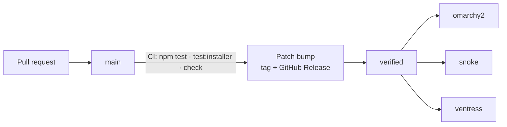

<h1 align="center">Eric's Herdr Linear</h1>

<p align="center">
  <strong>A spaces-first <a href="https://herdr.dev/">Herdr</a> layout for working through Linear issues.</strong><br>
  Your spaces fill the sidebar, grouped by <strong>Needs you</strong>, <strong>Done</strong>,
  <strong>Working</strong> and <strong>Idle</strong>, so whatever is waiting on you is the first thing you see.
</p>

<p align="center">
  <a href="https://github.com/EricGrill/erics-herdr-linear/actions/workflows/verify.yml"></a>
  <a href="https://github.com/EricGrill/erics-herdr-linear/releases/latest"></a>
  <a href="https://herdr.dev/layouts/"></a>
  <a href="LICENSE"></a>
</p>

<p align="center">
  <picture>
    <source media="(prefers-color-scheme: dark)" srcset="preview-dark.png">
    
  </picture>
</p>

<p align="center">
  <a href="#quickstart">Quickstart</a> ·
  <a href="#what-it-does">What it does</a> ·
  <a href="#shortcuts">Shortcuts</a> ·
  <a href="#how-a-change-reaches-your-machines">Updates</a> ·
  <a href="docs/">Docs</a> ·
  <a href="RECIPE.md">Recipe</a>
</p>

---

## Quickstart

Install and open [Herdr](https://herdr.dev/) once first. Then:

```sh
git clone https://github.com/EricGrill/erics-herdr-linear.git
cd erics-herdr-linear
python3 scripts/install.py --select
```

`--select` switches Herdr to the layout and verifies that Herdr confirms it. You can also
pick **erics-linear** in **Herdr Settings → Look**.

Review the [recipe](RECIPE.md) and the source before installing. These are trusted native
mods: they run commands through Herdr, read machine-local configuration and Linear
sign-in state, make Linear API requests, and can create worktrees or launch agents when
you use those actions. They do not include your account credentials or another person's
screen state.

> **Requirements** — Herdr **0.1.13** (exercised on macOS and Linux), Python 3.8+ to
> install, Git to update, Node.js for the optional test suite.

More: [install flags and what gets backed up](docs/install.md) ·
[Linear API key and other settings](docs/configuration.md)

## What it does

| | |
| --- | --- |
| **Waiting work comes first** | Spaces group into Needs you, Done, Working and Idle. The current group's header stays pinned while you scroll, and the Needs you count sits beside the window title even with the sidebar collapsed. |
| **By status / By project** | Switch the sidebar between state groups and one group per Linear project. Click any group header to collapse it; the choice and collapsed groups are remembered. |
| **Every space carries its ticket** | Each row shows its Linear issue and machine. Each machine keeps the same colored dot after every restart, and remote machines say when they are offline or reconnecting. |
| **Pins, tags and colors live in Linear** | **Pin to top** and **Tags…** write workspace labels, so a space looks the same on every machine. Rows show up to two tags as chips in their Linear colors, with a stripe in the first tag's color. |
| **Clean up (N)** | Appears when spaces are finished — ticket Done or Canceled, or pull request merged. It lists each with what its checkout holds and closes the picked ones at once, optionally removing clean worktrees with `git worktree remove` (never forced; the branch is kept). |
| **Auto-close** | A space whose ticket has been Done or Canceled for 10 minutes closes itself — unless it is the space you are in, pinned, has an agent working or waiting, or has uncommitted edits. Only the space closes; its ticket, folder and branch stay. |
| **Projects, Crew and Agents** | Three popups from the top: the full project tree with search and task creation; every Linear agent's open issue queue with attention reasons and verified reassignment; and live Herdr agents, including remote agents and subagents. |
| **Create or attach a ticket** | Create a ticket before starting a task in its worktree, or attach an existing space to a ticket without moving its files or changing its branch. |
| **Pick the execution computer** | Choose the machine, then an existing Git repository under that computer's `~/code`, instead of a local-only folder picker. |
| **Still a Herdr terminal** | Terminal tabs, pane controls, Files and Changes are all retained. The issue header reads status · priority · delegate or assignee · pull request and checks · lines changed; the status bar shows the machine, commits ahead/behind, uncommitted changes, and how long the agent has been working. |

The grouping is a view of work, not workflow automation. **Finishing an agent run does not
mark a Linear ticket Done.** Commands typed directly into a terminal can still start
unlinked work; the issue header identifies spaces that have no ticket.

Full behaviour: [What the layout does](docs/features.md) ·
[Create a task and choose where it runs](docs/tasks.md)

## Shortcuts

All bindings are scoped to `erics-linear`. Escape closes a dialog or popup, and the top
buttons also open Projects, Crew and Agents.

| Action | macOS | Linux |
| --- | --- | --- |
| Live Agents popup | <kbd>Cmd</kbd>+<kbd>Option</kbd>+<kbd>A</kbd> | <kbd>Alt</kbd>+<kbd>Shift</kbd>+<kbd>A</kbd> |
| Crew delegates | <kbd>Cmd</kbd>+<kbd>Shift</kbd>+<kbd>C</kbd> | <kbd>Alt</kbd>+<kbd>Shift</kbd>+<kbd>C</kbd> |
| Issue panel | <kbd>Cmd</kbd>+<kbd>Shift</kbd>+<kbd>I</kbd> | <kbd>Alt</kbd>+<kbd>Shift</kbd>+<kbd>I</kbd> |
| Issue delegate panel | <kbd>Cmd</kbd>+<kbd>Shift</kbd>+<kbd>A</kbd> | <kbd>Alt</kbd>+<kbd>Shift</kbd>+<kbd>D</kbd> |
| Files | <kbd>Cmd</kbd>+<kbd>Shift</kbd>+<kbd>F</kbd> | <kbd>Alt</kbd>+<kbd>Shift</kbd>+<kbd>F</kbd> |
| Toggle side panel | <kbd>Cmd</kbd>+<kbd>Shift</kbd>+<kbd>E</kbd> | <kbd>Alt</kbd>+<kbd>Shift</kbd>+<kbd>E</kbd> |
| Clear delegate filter | <kbd>Cmd</kbd>+<kbd>Shift</kbd>+<kbd>X</kbd> | <kbd>Alt</kbd>+<kbd>Shift</kbd>+<kbd>X</kbd> |

Your desktop or window manager may reserve one of these; adjust this layout's section in
`keys.json` if so.

## How a change reaches your machines

This repository is the source of truth. Installed copies under `~/.config/herdr-app` are
deployment outputs — editing them does not edit or push the repository.



Every push to `main` that passes CI gets the next patch version (0.1.1 → 0.1.2) in
`package.json` and the sidebar footer together, released as a tag and a
[GitHub Release](https://github.com/EricGrill/erics-herdr-linear/releases), with the
`verified` branch fast-forwarded to that commit. Each machine's updater polls `verified`
every five minutes, installs exactly that commit, and reports back as a
`deploy/<machine>` commit status, so GitHub shows which machines are actually running the
release. Nothing is overwritten: a checkout with local changes, off `main`, or ahead of
`verified` is skipped and reported.

Turn the updater on once per machine, or pull a published update by hand:

```sh
python3 scripts/auto_update.py install --machine snoke   # omarchy2, snoke, ventress
bash scripts/update.sh                                   # or just pull and install now
```

Don't bump the version in a PR — every deploy takes the next patch automatically. Details,
including minor/major releases and SSH sync to named hosts:
[Keeping machines in sync](docs/multi-machine.md).

## Verify a change

```sh
npm test                 # mod unit tests
npm run test:installer   # installer tests
npm run check            # release structure, layout IDs, imports, SVGs, version match
```

Then run a native check on each touched mod and look at the live window:

```sh
for mod in linear-board linear-workspace linear-workspace-tabs erics-linear-agents erics-linear-chrome; do
  herdr-app check "mods/$mod"
done
```

A native check validates an initial render, not every later state. Also inspect the live
Spaces view, Projects popup, Agents popup, and the create/attach flows. Tests never call
real Linear, read credentials, create live tickets, or start agents, and public
screenshots use demonstration data. See [CONTRIBUTING.md](CONTRIBUTING.md).

## Documentation

| | |
| --- | --- |
| [`docs/`](docs/) | Guides for features, install, tasks, configuration, multi-machine sync and agent permissions — plus the design records behind them. |
| [`RECIPE.md`](RECIPE.md) | The gallery recipe: what the window looks like, how it behaves, what it is built from. |
| [`AGENTS.md`](AGENTS.md) | Working rules for agents making changes in this repository. |

## Gallery and licensing

This repository is structured for [Herdr's layout gallery](https://herdr.dev/layouts/#share):
the root contains `RECIPE.md`, `preview.png`, `layouts/` and `mods/`. A public repository
with the `herdr-layout` topic is discovered automatically. Herdr's stated discovery window
is within an hour; a published GitHub repository alone is not proof of a gallery listing.
Community preview images are screened, while layout code is not reviewed by Herdr.

Original contributions are available under the [MIT license](LICENSE). Copied and adapted
upstream portions retain their respective Apache-2.0, MIT and ISC terms. See
[third-party notices](THIRD_PARTY_NOTICES.md) and the full texts in [`licenses/`](licenses/).

> This is an independent community layout, not an official Herdr or Linear product.
