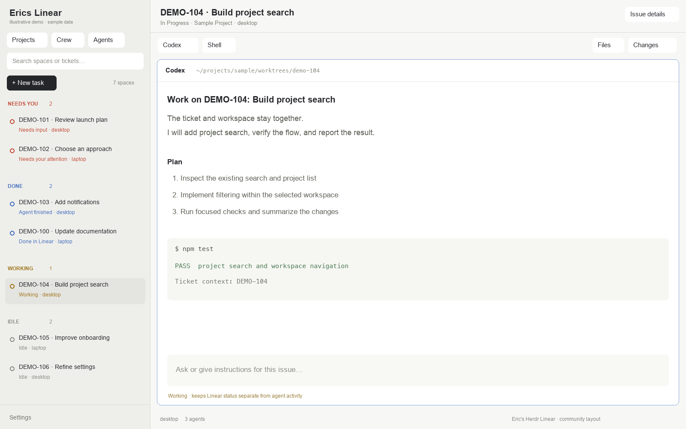

# Eric's Herdr Linear

A spaces-first [Herdr](https://herdr.dev/) layout for working through Linear issues. Your
spaces fill the sidebar, grouped by **Needs you**, **Done**, **Working**, and **Idle**.
**Projects**, **Crew**, and **Agents** open from the top when you need them.



The layout ID is `erics-linear`; its window header reads **Erics Linear**.
The expanded sidebar shows **Layout v0.1.0** beside Settings, using this repository's
`package.json` version. Keep the sidebar-footer version in `layouts/erics-linear.json`
in sync when releasing; `npm run check` verifies they match.

## What it does

- Puts work needing attention before finished, working, and idle spaces.
- Shows each space's Linear ticket and machine. Click a space to return to its terminal.
- Keeps the full project tree in a separate popup, with search and task creation.
- Shows live Herdr agents in a scrollable popup, including remote agents and subagents.
- Shows each Linear agent's full open issue queue in Crew, with attention reasons, issue
  inspection and verified reassignment, without treating a delegated ticket as a running agent.
- Creates a ticket before starting a task in its worktree, or attaches an existing space
  to a ticket without moving its files or changing its branch.
- Lets you choose the execution computer, then an existing Git repository under that
  computer's `~/code`, instead of using a local-only folder picker.
- Retains Herdr's terminal tabs, pane controls, Files, Changes, and status bar.

The grouping is a view of work, not a workflow automation. Finishing an agent run does
not mark a Linear ticket Done. Commands typed directly into a terminal can still start
unlinked work; the issue header identifies spaces that have no ticket.

## Create a task or capture an idea

Choose **New task** from the issue list, a project, or the launcher. Write the request in
one multiline field, then **Create task**. The first nonempty request line supplies
the ticket title; the full request is retained as its description. The current task's project
and repository, or your previous compatible choices, are prefilled and editable.
Status, priority and assignment are remembered from the previous successful task and
remain available under **Ticket details**. Repository choices stay scoped to the
Linear workspace, project and computer. Existing capture commands and shortcuts open
the same form.

New task saves a local draft as you type, scoped to the selected Linear workspace in
that mod, using a stable persisted app key across dialog instances.
Closing the dialog or restarting Herdr restores it, including the selected
repository. **Discard draft** removes it explicitly. Storage failures and conflicting
revisions are shown instead of silently replacing another window's draft. Drafts remain
local to this app and are not synced between computers or the two mods. Existing idea
drafts open in this form with their original source preserved.

**Improve with AI** is optional. It sends the source idea, or the entered request, to OpenAI for editable suggestions. It uses the existing `gpt-6-luna`
Responses integration with tools disabled and `store: false`; this does not disable all
provider retention. It requires `OPENAI_API_KEY` in the Herdr process environment and
uses the account's API billing. Keys are not placed in preferences or command arguments.
No agent session or worktree is started for shaping. Without a key or on failure, the
local draft and direct creation remain available. Shaped tickets preserve their source
idea; its **Edit source idea** control also offers the existing local **Shape ticket**
template.

**Create task** validates and saves the selected repository with the ticket. A task can
also be created without a repository, then assigned one later. **Create & start** requires
an existing repository and an installed agent; its validated target and submitted text
are carried through to that launch. A failed or unconfirmed create retains the draft
and asks you to check recent issues before retrying, since a lost response can follow a
successful write. Finishing a task creation or agent run does not mark an issue Done.

## Choose where a task runs

In New task, write the request in **What needs doing?**. The title uses the first
line, shortened to 100 characters; the full text is saved as the description.
**Ticket details** lets you change the remembered status, priority and assignee.
Team and project remain editable. These choices are remembered per Linear workspace;
a removed or completed status falls back to an available open status.

Select **Computer**, then **Repository**. The repository list comes from
the selected computer's own `~/code`; it does not create or clone a missing repository.
Installed-agent choices are refreshed for that computer. Changing computers clears
stale repository and agent choices, and unavailable computers cannot be used.
New tasks remember the last project selected or visited in each Linear workspace.
Choosing a repository saves that project's computer and repository for future tasks
(or the workspace's choice when no project is selected),
with separate repository choices for each computer. Agent selections are also remembered
for each computer. These preferences persist in this
Herdr app and are shared by both Linear layouts. A missing saved repository stays
unselected until you choose an existing one.
The pinned worktree backend trims path output, so paths containing newlines or ending
in whitespace are rejected before any ticket or worktree mutation.

Both **Create issue** and **Create & start** validate the existing repository. Queued
issues retain their selected execution target. Starting work may create the issue's
worktree inside that existing repository; the base repository must already exist.
An owned JSON block in the issue description records the computer's stable Herdr
identity and repository path, so another client can resolve the same physical target.
It contains placement metadata, not credentials.

Choosing **This computer** explicitly targets the local machine even while a remote
space is focused. A saved target that cannot be resolved must be chosen explicitly;
the launcher must not silently substitute a different computer.
Launch actions, including keyboard shortcuts, are gated until the issue's saved
placement is ready. Create & start retains its validated request target while the
new issue's details load.

## Install

Install and open Herdr once first. This layout has been exercised with **Herdr 0.1.12** on
macOS and Linux. It uses Python 3.8+ for installation, Git for updates, and Node.js for the
optional test suite. The Linear adapter uses `curl`, `tar`, and a SHA-256 utility to obtain
its platform-specific backend if it is not already installed.

```sh
git clone https://github.com/EricGrill/erics-herdr-linear.git
cd erics-herdr-linear
python3 scripts/install.py
```

Use `--dry-run` to inspect the plan, `--update` to replace a previous installation with a
backup, or `--select` to select the layout and verify that Herdr confirms it. `--home PATH`
targets another Herdr configuration folder. `--config PATH` explicitly replaces the
machine-local non-secret preferences file before source updates; omitting it preserves
that file. Shortcut conflicts are reported rather than silently overwritten.

Select **erics-linear** in **Herdr Settings → Look**, or run this in a shell where Herdr's
CLI is available:

```sh
herdr-app do layout.switch --name erics-linear
```

Review the [recipe](RECIPE.md) and source before installing. These are trusted native mods:
they run commands through Herdr, read machine-local configuration and Linear sign-in
state, make Linear API requests, and can create worktrees or launch agents when you use
those actions. They do not include your account credentials or another person's screen
state.

The installer copies the custom layout and its five mods. It merges only this layout's
shortcut section; it does not replace your global keyboard settings, terminal sessions,
window geometry, or account state. Existing files are backed up before an update. A
local `.erics-linear-install.json` receipt records the source checkout, Git commit,
installed-file hashes, and check/selection results. If Herdr's CLI is unavailable, the
installer reports that native checks did not run; it cannot claim selection. Keep
your machine-local configuration outside this Git checkout.

## Linear setup

Task dialogs and the sidebar use the configured Linear API key when available, including
the Doppler fallback below. This lets projects, ticket creation, and Crew share access
without a separate browser sign-in. Credential values remain inside the shell that sends
the request; they are never stored in layout preferences.

When no API key is available, task dialogs can use the existing `herdr-linear` OAuth
sign-in. Worktree operations use backend version **0.14.2**, with downloaded release
archives checked against upstream checksums.

The optional configuration file is:

```text
~/.config/herdr-app/erics-linear.config.json
```

For an environment variable with a different name:

```json
{
  "enrichment": {
    "envKey": "MY_LINEAR_API_KEY"
  }
}
```

For optional Doppler fallback:

```json
{
  "enrichment": {
    "enabled": true,
    "envKey": "LINEAR_API_KEY",
    "doppler": {
      "project": "your-project",
      "config": "dev",
      "keyNames": ["LINEAR_API_KEY"]
    }
  }
}
```

The environment variable is checked first. This file contains **key names**, never key
values. Authenticate your secret manager separately on each machine. Do not commit API
keys, OAuth tokens, or Herdr's `shared.json`, `view.json`, caches, and `data/` directory.

To use Spaces and the basic Linear adapter without enrichment, set
`"enrichment": { "enabled": false }`. Configuration is reread on Refresh and periodically;
a malformed file reports an error and retains the last good configuration/display.

## Attention rules

Spaces enter Needs you when Herdr reports an agent needing input or their linked ticket
has a configured attention state or label. Generic defaults include Needs Human, In
Review, Blocked, Awaiting Review, and Ready for Review; labels include `needs-human`,
`agent:review-needed`, `agent:check-result`, `agent:stalled`, and `reopened:not-done`.

You can replace either list in the same machine-local configuration:

```json
{
  "attention": {
    "labels": ["needs-human", "needs-my-review"],
    "states": ["needs human", "ready for review", "blocked"]
  }
}
```

These arrays replace their defaults. An empty array disables that category. Done rows
distinguish **Agent finished** from **Done in Linear**, so the two sources remain clear.

## Shortcuts

All bindings are scoped to `erics-linear`.

| Action | macOS | Linux |
| --- | --- | --- |
| Live Agents popup | Cmd+Option+A | Alt+Shift+A |
| Crew delegates | Cmd+Shift+C | Alt+Shift+C |
| Issue panel | Cmd+Shift+I | Alt+Shift+I |
| Issue delegate panel | Cmd+Shift+A | Alt+Shift+D |
| Files | Cmd+Shift+F | Alt+Shift+F |
| Toggle side panel | Cmd+Shift+E | Alt+Shift+E |
| Clear delegate filter | Cmd+Shift+X | Alt+Shift+X |

The top buttons also open Projects, Crew, and Agents. Escape closes a dialog or popup.
The desktop/window manager may reserve a shortcut; adjust this layout's section in
`keys.json` if your environment uses one of these combinations.

## Keep several machines in sync

Treat this repository as the source of truth. Make changes in the checkout, test them,
commit, and push. Installing copies files into Herdr; editing the installed copy does not
automatically edit or push the repository.

On each machine, clone this repo once and install it. To receive a published update from
that checkout:

```sh
bash scripts/update.sh
```

The updater uses a fast-forward Git pull and then installs the checked-out version. A
dirty or divergent checkout needs to be resolved rather than discarded. There is no
unattended background updater.

From a machine with SSH access to your other computers, explicitly sync named targets:

```sh
bash scripts/sync.sh linux-desktop mac-mini
```

Add `--select` before the host names to select and verify the layout remotely. Sync uses
`~/code/erics-herdr-linear` on each target, verifies an existing checkout's origin, and
refuses dirty or detached checkouts. SSH and Git authentication are handled by your own
configuration. No credentials are copied.

Each machine keeps its own credentials, settings, window/terminal state, and
`erics-linear.config.json`. Updating the code does not share the workspaces themselves;
Herdr's machine connections determine which remote spaces are visible.

## Verify a change

```sh
node --experimental-default-type=module --experimental-vm-modules --test mods/linear-board/*.test.mjs mods/linear-workspace/*.test.mjs
herdr-app check mods/linear-board
herdr-app check mods/linear-workspace
herdr-app check mods/linear-workspace-tabs
herdr-app check mods/erics-linear-agents
herdr-app check mods/erics-linear-chrome
python3 -m unittest discover -s tests -p 'test_installer.py' -v
```

A native check validates an initial render, not every later state. Also inspect the live
Spaces view, Projects popup, Agents popup, and create/attach flows. Use demonstration data
for public screenshots. Test fixtures do not create live tickets or launch agents.

## Gallery and licensing

This repository is structured for [Herdr's layout gallery](https://herdr.dev/layouts/#share):
the root contains `RECIPE.md`, `preview.png`, `layouts/`, and `mods/`. A public repository
with the `herdr-layout` topic is discovered automatically. Herdr's stated discovery window
is within an hour; a published GitHub repository alone is not proof of a gallery listing.
Community preview images are screened, while layout code is not reviewed by Herdr.

Original contributions are available under the [MIT license](LICENSE). Copied and adapted
upstream portions retain their respective Apache-2.0, MIT, and ISC terms. See
[third-party notices](THIRD_PARTY_NOTICES.md) and the full texts in [`licenses/`](licenses/).
This is an independent community layout, not an official Herdr or Linear product.
