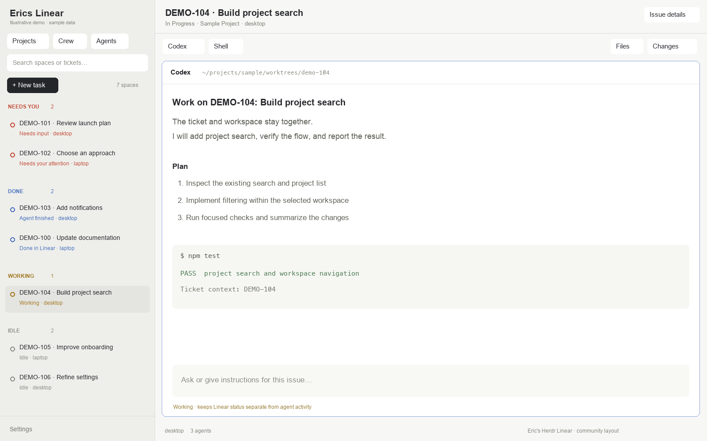

# Eric's Herdr Linear

A Herdr window whose sidebar is a queue of spaces, grouped by Needs you, Done, Working,
and Idle. Three buttons at the top open Projects, Crew, and Agents so optional browsing
does not displace the work. The main area stays a normal Herdr terminal workspace, with
the active issue shown above its tabs.

## What you see

The root is a horizontal split. The left sidebar starts at **300 px**, can be resized
between **44 and 480 px**, and uses the current theme's chrome surface. It has a **46 px**
brand row, a space list that takes the remaining height, and a **69 px** Settings/Add
machine footer. The header reads **Erics Linear**.

At the top of the list, Projects, Crew, and Agents are content-width buttons. A search
field filters spaces by name, ticket, machine, or agent title. New task sits beside the
number of matching spaces. Below it, non-empty groups appear in this order:

1. Needs you, using the theme's blocked color.
2. Done, using its done color.
3. Working, using its working color and a native spinning work icon.
4. Idle, using muted text and an idle icon.

Each space row is **49 px** tall. Its first line shows the issue identifier and title, or
the space name if unlinked; a tooltip provides the full text. The second line shows its
state and machine. An ellipsis opens issue details; an unlinked row has an attach action.
The active space gets the theme's selected surface. The list scrolls as one full-height
area rather than squeezing agents or another list below it.

The right column has a **44 px** issue-context header, a **42 px** tab bar, the active
tab's terminal/mod panes, and a **28 px** status bar. The work area has **8 px** padding
and gaps. Pane frames have **10 px** corners, **1 px** theme borders, an accent focus
border, and a **30 px** always-visible pane header. Files and Changes live in a hidden
side-panel stack that starts at **368 px**, with a **280–900 px** range.

The layout inherits the user's fonts, colors, zoom, and appearance. Do not bake the
preview's light theme into the implementation. Use theme tokens rather than fixed colors.

## How it behaves

Herdr supplies live spaces, agents, panes, terminals, and machines. A blocked agent puts
its space in Needs you. A linked ticket with an attention state or label also enters
that group. Finished agents and completed tickets appear in Done when the space is not
reported as working; the row distinguishes Agent finished from Done in Linear. Other
working spaces appear in Working, followed by Idle. Looking at an unseen finished agent
can change Herdr's report from done to idle; the UI reflects that live state. Grouping
does not change Linear workflow state.

Click a space to select it and focus its most relevant agent. Search Enter selects the
first matching space. Clicking an ellipsis opens the issue's state, description, labels,
branch, and pull requests. An unlinked workspace can attach to an existing issue without
moving its directory or changing its branch.

Projects opens a centered dialog with the complete team/project tree, search, issue
rows, New task, and Browse. Names containing `A · B` can fold under a synthetic group A
with leaf B. Expanding a project fetches its issues; loaded open projects refresh. Choose
a running issue to return to its space. Keep the project count inside this popup.

Crew opens a movable, kept two-column window: every Linear agent identity on the left
(including agents with nothing delegated), with open and needs-attention counts shown
separately, and the selected agent's complete open delegated queue on the right, read
from Linear by delegate whether or not any issue has a Herdr space. Selecting an agent
changes only the Crew view; it never filters the main Spaces list. Issues needing
attention (by the configured state and label rules) come first with their reason; open
blockers are shown as context. Herdr activity is a separate column, and "No Herdr space"
is a normal state. Loading, empty, error and incomplete (paginated or failed) reads are
labelled; a partial read is never shown as the whole queue.

Selecting an issue opens an inspector with its description, state, labels, blockers,
linked pull requests, the Linear link, and Open workspace when a space exists. One or
several issues can be reassigned to another Linear agent: the panel names the count,
source and destination, and any running Herdr sessions. Only the delegate is written;
each issue is read back from Linear to confirm the new delegate and that the assignee,
state, project and priority did not change. Failures are listed per issue and stay
selected for retry. Reassigning never stops, restarts or messages a running agent.

Agents opens the scrollable live Herdr agent dialog, preserving status grouping, remote
machine names, subagent trees, pinning, and sort controls. Selecting an agent closes the
dialog and focuses its terminal. Escape and the popup shortcut close it.

New task can create only a ticket or create and start it. Starting shows the repository,
machine, and installed-agent choice first, checks ticket eligibility and agent
availability, prepares a worktree, and opens a space with ticket context. Reopening a
worktree must still include that context. Existing open spaces are selected without
silently prompting their running agent. New follow-up references the source ticket in
the description; it is not a native parent/sub-issue relation.

Use layout-scoped shortcuts: Agents Cmd+Option+A on macOS or Alt+Shift+A on Linux; Crew
Cmd+Shift+C or Alt+Shift+C; issue panel Cmd+Shift+I or Alt+Shift+I; delegate panel
Cmd+Shift+A or Alt+Shift+D. Files, panel toggle, and clear filter use Cmd+Shift+F/E/X on
macOS and Alt+Shift+F/E/X on Linux. Preserve existing global and terminal bindings.

## Built from

The root tree is `sidebar` beside `work`. Sidebar contains `brand`, the flexible `board`
block, and `sidebar-footer`. Work contains `issue-context`, `tabs`, `work-body`, and
`status`. Work-body contains the active tab and the initially hidden `panel` stack.

Custom modules:

- `erics-linear-chrome`: cloned Herdr workspace chrome with the title changed; `footer`
  props select Settings/Add machine.
- `linear-board`: the spaces-first sidebar and its shared Linear data owner. Its props
  roles also render `header`, `projects`, `crew`, `issue`, and `agent` views.
- `linear-workspace-tabs`: cloned tab bar whose plus menu opens ticket-based launchers.
- `linear-workspace`: the underlying launcher/dialog implementation used by that plus
  menu. Retain it even though the main sidebar uses linear-board.
- `erics-linear-agents`: cloned Herdr Agents mod, displayed in a centered dialog with
  enough room for its scrollable list; it must not inherit compact sidebar rendering
  simply because the actual sidebar is narrow.

Reuse the installed `pane`, `files`, `changes`, and `workspace-status` mods and the app's
icons. Native GPUI builders (`div`, `h_flex`, `v_flex`, retained inputs, scroll areas) draw
the interface. `theme`, `spaces`, `panes`, `agents`, `terminals`, `machines`, `shared`, and
`setShared` provide data. `space.select`, `agent.focus`, `pane.focus`, `tab.new`, panel
commands, and overlays perform actions. Set agent navigation order to match the visible
queue. Use native `.spin()` for activity, not redraw timers.

The Linear client uses the `herdr-linear` backend, pinned to **0.14.2**, for sign-in,
lists, details, creation, status changes, and worktree operations. It provisions the
matching release archive when absent and verifies its checksum. Delegate and label
enrichment uses Linear GraphQL because the adapter does not expose those fields.

Configuration is machine-local at `appHome()/erics-linear.config.json`. The default
enrichment source is an environment variable named LINEAR_API_KEY; configurable Doppler
fallback is optional. Store only key names and non-secret preferences in configuration.
Attention states/labels are configurable. Keep credentials out of process arguments and
Git. Configuration refreshes periodically and on Refresh; failures retain a last good
display and report the error.

## Watch out

- Mods are native JavaScript, not HTML/CSS or browser views. They execute programs and
  contact Linear. Read their files before installing.
- Do not overwrite shipped Herdr mods or frame code. Personal clones are not
  automatically updated by Herdr; this repository owns their changes.
- Never mutate view state while rendering, and defer shared-state changes from a click
  handler so sibling renders are not re-entered. Never retain a `cx` for later use.
- A `size_full` scrollable agent list needs a bounded dialog. A content-sized popup can
  collapse to its header and hide all rows.
- Herdr agent status and Linear issue state are different. Keep the two visible and do
  not infer merges, deployments, or ticket completion from an agent finishing.
- Keep issue/space links in shared machine-local state, including workspace, machine,
  and exact folder identity. Similar path prefixes must not attach unrelated work.
- Do not copy `shared.json`, `view.json`, caches, account credentials, or active terminals
  into the repo or another machine. Fonts, zoom, and global keys belong to each user.
- Native checks only cover an initial render. Exercise later popup and asynchronous
  states in a real running Herdr window.
- macOS and Linux are the supported targets for the bundled adapter; do not promise
  Windows worktree/backend behavior. A desktop/window-manager binding may intercept a
  configured shortcut.
- The public preview must contain demonstration data, not private ticket text, host
  names, paths, terminal output, or account details.

## Done when

- The selected `erics-linear` layout shows a full-height Spaces queue without the project
  tree taking its place or another cramped list underneath it.
- Needs you, Done, Working, and Idle groups display their actual source states; clicking
  a row returns to its terminal and the issue header follows the selected space.
- Projects, Crew, and Agents open from the top; the full project tree remains searchable
  in its popup and the Agents list scrolls without clipping its rows.
- Creation, attach, and explicit agent continuation preserve ticket context, avoid
  duplicate prompts to an existing agent, and fail visibly when eligibility or agent
  checks fail.
- All five custom mods pass `herdr-app check`; the Node tests pass; the live layout and
  deferred dialog states have been visually inspected.
- Installing/updating on another machine preserves that machine's settings, credentials,
  shortcuts outside this layout, and terminal state.
- The distributable folder contains this recipe, a sanitized `preview.png`, the layout,
  its required mods, scoped shortcut instructions, and upstream license notices.
